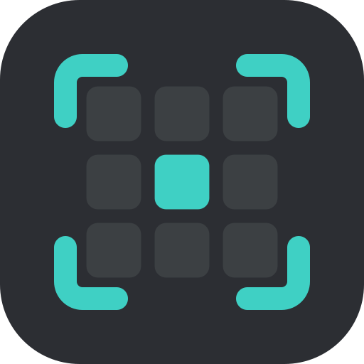

<p align="center"></p>
<h1 align="center">Recon</h1>
<p align="center">Scouting for VEX V5 teams.<br>Made by <b>Invictus 52111A</b>.</p>

Recon is a phone-first scouting app. A team signs up once with its VEX team number, shares its team code, and
everyone on the team scouts together, live: match notes, scouting forms, rankings, OPR and a finals picklist.
It keeps working on bad venue wifi and installs to the home screen like an app.

Every team's scouting is private to that team. Event lists, matches and rankings come from VEX Events.

## For teams
1. Open Recon and tap **Set up a new team**. Enter your team number; Recon checks it on VEX Events.
2. You get a **team code** (like `G5TS-3M3X`). Share it with your team.
3. Teammates open Recon, tap **Join your team** and enter your team number and the code.
4. On the Event tab, use **Find an event** (your team's events, what's coming up, or earlier this season; search by name,
   city or code) and tap **Add**. Or type an event code (e.g. `RE-V5RC-26-5068` or `VE-V5-26-66510`) or paste the event page link, and press **Import**.

**Spectators.** Parents, friends and other teams can choose **Spectator** on the sign-in screen and enter a team number, no code,
to follow that team: matches with times and fields, rankings, OPR and skills, view-only. They never get the team's scouting
notes, scout names or picklist, and the server rejects anything that would change data. The team has to be on Recon already.
A team can turn this off in Team settings → Spectators.

Lost the code? Anyone already signed in can see it in **Team settings** (Event tab → More), and can make a
new one there; the old one then stops working on every phone.

**Recovery key.** Setting up a team also gives a recovery key (like `ABCD-EFGH-JKMN-PQRS`). The coach or mentor keeps it
somewhere safe, not in the team chat. If **nobody** is signed in and nobody has the team code, tap **Lost the code?** on
the sign-in screen, enter the team number and recovery key, and get a new team code (the old one stops working). Teams
without a key (set up before keys existed) make one in Team settings → Recovery key. If the key is lost too, the app's owner
can reset the code (see Admin).

## What's in it
- **Matches**: your matches or all of them, when each is scheduled and which field it's on, scores, W/L, and strategy / partner / opposition notes per match.
- **Event tab**: one place for the event. The picker sits on top, then **Teams** (searchable, with rank, skills and OPR on
  each row), **Rankings**, **Skills** and **More** (event notes, import another event, team settings).
- **Scouting**: the Scout tab is the one place to write it (a team's page has a **Scout this team** button that opens it).
  One overall entry per scout per team, plus one per match watched; averages on each team's page. The list opens on
  **To scout** so you can see what's left. The form is split into titled sections (Autonomous, Driver, Robot, Scoring,
  Toggle, Overall); every field keeps its label once filled in, ratings say what 1 and 5 mean, and **Toggle mechanism**
  is a text box for describing how they toggle. Saved entries are shown grouped and labelled.
- **Rankings & OPR**: official rankings from VEX Events (refreshed with the scores), OPR / DPR / CCWM worked out
  from qualification scores, calculated standings until the official ones exist. Average and high score per match too.
- **Skills & season stats** (Event tab → Skills, and each team's page): works with no matches being played. For every team
  at the event: highest and average driver and autonomous (programming) skills, the combined score and who leads the field,
  for the whole season or just this event. A team's page adds its season record and win rate, average and high score, every
  event it has played and its awards. It comes from VEX Events for the whole season, so the event must be imported with its
  event code. The server loads it a few teams at a time (about a minute for a full event, 3 requests per team) the first
  time an event is opened and again once it is 6 hours old; **Refresh** on the Skills page loads it now.
- **Robot photos**: on each team's page, up to 3 photos per team per event (camera or gallery), shared with your team. The phone
  shrinks each to about 150 KB before sending, and with no signal they wait and upload later. They sit in D1 in their own
  `photos` collection (no extra table or storage service, nothing to set up), are fetched only when a team's page opens, and are
  never shown to spectators. A team keeps photos for its 5 most recent events (by start date); older ones are deleted automatically.
- **Picklist**: drag or use the arrows; rank and OPR shown on each row. Alliance requests live here too, with an **Add to picklist** button.
- **Live and offline**: teammates' changes show up within seconds; with no signal, changes are kept on the phone
  and sent when it's back (the header shows `Offline · 3 unsaved`).
- Light and dark mode, animations that respect "reduce motion", installable (PWA).

## Hosting it (Invictus 52111A)
Recon runs on Cloudflare Pages: the page in `public/`, one Pages Function (`functions/api/[[path]].js`) that answers
`/api/*` and holds the VEX Events API key, and a D1 database (`schema.sql`) that stores every team's data, kept apart per team.
The live site is **https://vexrecon.pages.dev**.

### Deploy to vexrecon.pages.dev
Needs Node.js and a free Cloudflare account.

1. Sign in and create the database (once):
   ```
   npm install
   npx wrangler login
   npx wrangler d1 create vexrecon
   ```
   (Already done for this project: `wrangler.toml` has the `vexrecon` database id.) Otherwise copy the `database_id` it prints into `wrangler.toml`.
2. Create the table:
   ```
   npm run db:remote
   ```
3. Create the Pages project (once) and deploy. The project name `vexrecon` is what makes the address `vexrecon.pages.dev`:
   ```
   npx wrangler pages project create vexrecon --production-branch main
   npm run deploy
   ```
   (Or in the dashboard: Workers & Pages → Create → Pages → connect the GitHub repo, build command empty, output
   directory `public`, then Settings → Bindings → add a D1 binding named `DB` pointing at `vexrecon`.)
4. Add the secrets: Workers & Pages → vexrecon → Settings → Variables and Secrets (or `npx wrangler pages secret put ROBOTEVENTS_KEY`).
5. Deploy again so the variables take effect (`npm run deploy`, or retry the latest deployment in the dashboard).

| Variable | |
|---|---|
| `ROBOTEVENTS_KEY` | VEX Events API key (secret). Needed to import events and to check team numbers at sign-up. |
| `ADMIN_CODE` | Optional, secret. Lets the owner reset or remove a team (see below). |
| `TEAM_CODE` | Only for the original single-team install: the old Invictus code. The first time 52111A signs in with it, 52111A is set up as a team (its data space is `scout`). Can be removed afterwards. |
| `LEGACY_TEAM`, `LEGACY_TEAM_NAME` | Optional overrides for that original team (default `52111A`, `Invictus`). |

**Moving over from Netlify.** Data kept in Netlify Blobs is not copied across: teams set up again (or sign in with their
old code, for 52111A) and re-import their events. Scouting notes made on Netlify have to be exported from the old site first.

**Free plan limits.** A request may make at most 50 calls to VEX Events and uses about 10 ms of CPU. A full event import
makes 1 + (team pages) + (one per division) calls (24 for a 10-division, 700-team event) and gets the rankings on the next
quick refresh if there are too many calls left. The team code check is kept light for the CPU limit (see Security notes).
The phones check for changes every 10 seconds, which stays well inside D1's free reads.

### Admin
If someone sets up a team number that isn't theirs, or a team has lost both its code and its recovery key:

```
curl -X POST https://vexrecon.pages.dev/api/admin -H "content-type: application/json" \
  -d '{"adminCode":"<ADMIN_CODE>","team":"1234B","action":"reset"}'
```

`reset` returns a new team code; `remove` deletes the team's sign-up (its data is kept, so it can be
restored).

### Security notes
- Team codes are generated (8 characters, about 40 bits), stored only as salted PBKDF2 hashes, and checked in
  constant time. The recovery key (16 characters, about 80 bits) is stored the same way. After 10 wrong codes or
  wrong recovery keys a team number is locked for 10 minutes.
- The VEX Events key never reaches the browser.

## Preview on your PC
Needs Node.js. Create `.dev.vars` in this folder:
```
ROBOTEVENTS_KEY=your-key
ADMIN_CODE=anything
```
Then:
```
npm install
npm run dev
```
Open http://localhost:8888 (or `http://<your PC's IP>:8888` on a phone on the same wifi). The data is kept in a local D1
database under `.wrangler/`. Without a real API key, team numbers aren't checked and event import won't work; add events,
teams and matches by hand instead.

## Licence
Proprietary. Copyright © 2026 Invictus 52111A. All rights reserved. See [`LICENSE`](LICENSE).
Recon is not affiliated with or endorsed by VEX Robotics or the REC Foundation.
