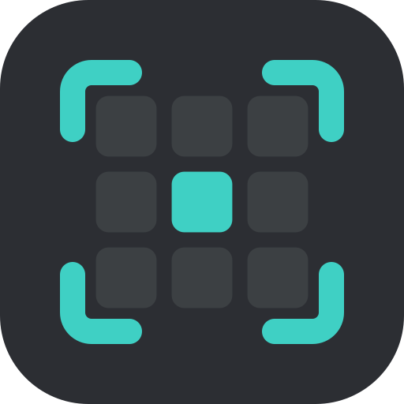

<p align="center"></p>
<h1 align="center">Recon</h1>
<p align="center">Scouting for VEX V5 teams.<br>Made by <b>Invictus 52111A</b>.</p>

Recon is a phone-first scouting app. A team signs up once with its VEX team number, shares its team code, and
everyone on the team scouts together, live: match notes, scouting forms, rankings, OPR and a finals picklist.
It keeps working on bad venue wifi and installs to the home screen like an app.

Every team's scouting is private to that team. Event lists, matches and rankings come from VEX Events.

## For teams
1. Open Recon and tap **Set up a new team**. Enter your team number; Recon checks it on VEX Events.
2. You get a **team code** (like `G5TS-3M3X`). Share it with your team.
3. Teammates open Recon, tap **Join your team** and enter your team number and the code.
4. On the Event tab, use **Find an event** (your team's events, what's coming up, or earlier this season; search by name,
   city or code) and tap **Add**. Or type an event code (e.g. `RE-V5RC-26-5068` or `VE-V5-26-66510`) or paste the event page link, and press **Import**.

Lost the code? Anyone already signed in can see it in **Team settings** (Event tab → More), and can make a
new one there; the old one then stops working on every phone. If **nobody** is signed in, tap **Lost the code?** on the
sign-in screen and ask for a new one: it is handed to that device after a day (`RECOVER_MINUTES`), and anyone still
signed in sees a notice and can cancel it.

## What's in it
- **Matches**: your matches or all of them, scores, W/L, and strategy / partner / opposition notes per match.
- **Event tab**: one place for the event. The picker sits on top, then **Teams** (searchable, with rank, skills and OPR on
  each row), **Rankings**, **Skills** and **More** (event notes, import another event, team settings).
- **Scouting**: the Scout tab is the one place to write it (a team's page has a **Scout this team** button that opens it).
  One overall entry per scout per team, plus one per match watched; averages on each team's page. The list opens on
  **To scout** so you can see what's left. The form is split into titled sections (Autonomous, Driver, Robot, Scoring,
  Toggle, Overall); every field keeps its label once filled in, ratings say what 1 and 5 mean, and **Toggle mechanism**
  is a text box for describing how they toggle. Saved entries are shown grouped and labelled.
- **Rankings & OPR**: official rankings from VEX Events (refreshed with the scores), OPR / DPR / CCWM worked out
  from qualification scores, calculated standings until the official ones exist. Average and high score per match too.
- **Skills & season stats** (Event tab → Skills, and each team's page): works with no matches being played. For every team
  at the event: highest and average driver and autonomous (programming) skills, the combined score and who leads the field,
  for the whole season or just this event. A team's page adds its season record and win rate, average and high score, every
  event it has played and its awards. It comes from VEX Events for the whole season, so the event must be imported with its
  event code. The server loads it a few teams at a time (about a minute for a full event, 3 requests per team) the first
  time an event is opened and again once it is 6 hours old; **Refresh** on the Skills page loads it now.
- **Picklist**: drag or use the arrows; rank and OPR shown on each row. Alliance requests live here too, with an **Add to picklist** button.
- **Live and offline**: teammates' changes show up within seconds; with no signal, changes are kept on the phone
  and sent when it's back (the header shows `Offline · 3 unsaved`).
- Light and dark mode, animations that respect "reduce motion", installable (PWA).

## Hosting it (Invictus 52111A)
Recon runs on Netlify: the page in `public/` and one function, `netlify/functions/api.mjs`, which stores each
team's data in Netlify Blobs (one private store per team) and holds the VEX Events API key.

Environment variables (Netlify → Site configuration → Environment variables):

| Variable | |
|---|---|
| `ROBOTEVENTS_KEY` | VEX Events API key (secret). Needed to import events and to check team numbers at sign-up. |
| `ADMIN_CODE` | Optional, secret. Lets the owner reset or remove a team (see below). |
| `TEAM_CODE` | Only for the original single-team install: the old Invictus code. The first time 52111A signs in with it, the existing data is adopted as team 52111A's space. Can be removed afterwards. |
| `RECOVER_MINUTES` | Optional. How long a "lost the code" request waits before the new code is handed over (default 1440 = one day). |
| `LEGACY_TEAM`, `LEGACY_TEAM_NAME` | Optional overrides for that original team (default `52111A`, `Invictus`). |

After changing variables: **Deploys → Trigger deploy**.

### Admin
If someone sets up a team number that isn't theirs, or a team loses its code and can't wait for the one-day self-service reset:

```
curl -X POST https://<your-site>/api/admin -H "content-type: application/json" \
  -d '{"adminCode":"<ADMIN_CODE>","team":"1234B","action":"reset"}'
```

`reset` returns a new team code; `remove` deletes the team's sign-up (its data store is kept, so it can be
restored).

### Security notes
- Team codes are generated (8 characters, about 40 bits), stored only as salted scrypt hashes, and checked in
  constant time. After 10 wrong codes a team number is locked for 10 minutes.
- The VEX Events key never reaches the browser.

## Preview on your PC
Needs Node.js. Create `.env` in this folder:
```
ROBOTEVENTS_KEY=your-key
ADMIN_CODE=anything
```
Then:
```
npm install
npm install -g netlify-cli
netlify dev
```
Open http://localhost:8888 (or `http://<your PC's IP>:8888` on a phone on the same wifi). Without a real API key,
team numbers aren't checked and event import won't work; add events, teams and matches by hand instead.

## Licence
Proprietary. Copyright © 2026 Invictus 52111A. All rights reserved. See [`LICENSE`](LICENSE).
Recon is not affiliated with or endorsed by VEX Robotics or the REC Foundation.
